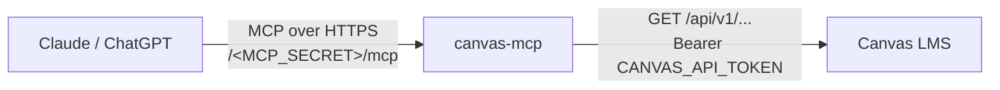

# canvas-mcp

[](https://github.com/boyuchengz/canvas-mcp/actions/workflows/ci.yml)
[](LICENSE)


English | [简体中文](README.zh-CN.md)

A **read-only** [Model Context Protocol](https://modelcontextprotocol.io) server for [Canvas LMS](https://www.instructure.com/canvas).
Deploy it once, add it as a custom connector in Claude or ChatGPT, and ask questions about your courses in plain language:

> *What's due this week, and which of it have I already submitted?*
> *What do I need on the final to keep an A in CS 225?*
> *Summarize the announcements from the last two weeks.*
> *Did the TA leave any comments on my last lab?*

Every one of the 26 tools issues `GET` requests only. The server cannot submit, post, delete or mark anything as read, so even a leaked connector URL only exposes what you could already see.

## Contents

- [Features](#features)
- [Tools](#tools)
- [How it works](#how-it-works)
- [Quick start](#quick-start)
- [Connecting a client](#connecting-a-client)
- [Configuration](#configuration)
- [Security](#security)
- [Limitations](#limitations)
- [Development](#development)
- [Contributing](#contributing)
- [License](#license)

## Features

- **Strictly read-only.** No write endpoints are wrapped, and reads that Canvas would normally treat as "viewed" (inbox threads, discussions) are made without side effects.
- **Built for students.** Tools answer the questions students actually ask: deadlines across all courses, missing work, grade weights, feedback, syllabus policies.
- **Compact output.** Canvas HTML is converted to plain text and responses are trimmed to the fields a model needs, which keeps token usage low.
- **Remote by design.** Speaks MCP over Streamable HTTP, so it works with web and mobile clients, not just desktop apps.
- **Stateless.** Each request gets a fresh server instance. Nothing is cached or stored; scale to zero without losing anything.
- **Small.** Three runtime dependencies, no build step, no database.

## Tools

| Area | Tool | What it returns |
| --- | --- | --- |
| Courses | `list_courses` | Active courses with IDs, codes and terms |
| | `get_syllabus` | Syllabus text |
| | `get_front_page` | Course home page text |
| | `list_modules` | Modules and the items inside each |
| | `list_pages` / `get_page` | Wiki pages and their contents |
| | `list_course_staff` | Instructors and TAs, with email when visible |
| | `list_groups` | Your project / lab groups |
| Coursework | `get_upcoming` | Everything due in the next *N* days, with submission status |
| | `get_todo` | Canvas To Do list |
| | `get_missing` | Past-due work you haven't submitted |
| | `list_assignments` / `get_assignment` | Assignments, instructions, rubric, your score and feedback |
| | `list_quizzes` / `get_quiz` | Classic Quizzes, settings and your attempts |
| | `get_calendar_events` | Lectures, exams and office hours from the calendar |
| Grades | `get_grades` | Current and final score in every course |
| | `get_grade_breakdown` | Assignment groups, weights, drop rules and every score |
| Files | `list_files` / `get_file` | Course files; text-based files are returned inline |
| Communication | `get_announcements` | Recent announcements across courses |
| | `list_discussions` / `get_discussion` | Discussion topics and full reply threads |
| | `list_inbox` / `get_inbox_message` | Inbox conversations and messages |
| | `get_recent_activity` | Activity stream: new grades, comments, replies |

Parameters and output fields for each tool are documented in [docs/tools.md](docs/tools.md).

## How it works



The AI client calls the server at a URL that contains a long random secret. The server checks the secret in constant time, translates the tool call into one or more Canvas REST API `GET` requests using your personal access token, follows pagination, and returns a trimmed JSON result. The Canvas token never leaves the server.

## Quick start

### 1. Create a Canvas access token

In Canvas, open **Account → Settings**, scroll to **Approved Integrations**, and click **+ New Access Token**. Give it a purpose (e.g. "canvas-mcp") and an expiry date, then copy the token. Canvas only shows it once.

> Some institutions restrict personal access tokens. Check your school's acceptable-use policy before deploying.

### 2. Generate a connector secret

```bash
node -e "console.log(require('crypto').randomBytes(24).toString('hex'))"
```

### 3. Deploy

The server runs anywhere Node.js 20+ can accept HTTPS traffic. [Railway](https://railway.com) is the quickest option:

```bash
npm i -g @railway/cli
railway login
railway init
railway up
```

Then, in the Railway dashboard:

1. **Variables**: add `CANVAS_BASE_URL`, `CANVAS_API_TOKEN` and `MCP_SECRET`.
2. **Settings → Networking**: click **Generate Domain**.

Your connector URL is:

```
https://<your-domain>/<MCP_SECRET>/mcp
```

Render, Fly.io, a VPS and local setups are covered in [docs/deployment.md](docs/deployment.md).

## Connecting a client

**Claude** (claude.ai, desktop and mobile): open **Settings → Connectors**, choose **Add custom connector**, and paste the connector URL. Leave the OAuth fields empty.

**ChatGPT**: enable developer mode for connectors, create a new connector, paste the connector URL and choose **No authentication**.

**Claude Code**:

```bash
claude mcp add --transport http canvas https://<your-domain>/<MCP_SECRET>/mcp
```

**Any other MCP client** that supports the Streamable HTTP transport can use the same URL.

Start a conversation with something like *"List my Canvas courses"* to confirm it works.

## Configuration

| Variable | Required | Description |
| --- | --- | --- |
| `CANVAS_BASE_URL` | yes | Your Canvas instance, e.g. `https://canvas.instructure.com` or `https://canvas.<school>.edu` |
| `CANVAS_API_TOKEN` | yes | Personal access token from Canvas |
| `MCP_SECRET` | yes | Random string of at least 24 URL-safe characters (`A–Z a–z 0–9 - _`); becomes part of the connector URL |
| `PORT` | no | Port to listen on. Defaults to `8080`; most platforms set it for you |

The server validates all variables at startup and exits with a clear message if anything is missing.

## Security

- **Read-only by construction.** The Canvas client only exposes `GET` helpers. There is no code path that writes to Canvas.
- **Secret in the path.** Requests without the correct secret receive the same `404` as any unknown URL, so the endpoint isn't discoverable. The comparison is constant-time.
- **Token isolation.** The Canvas token is sent only to `CANVAS_BASE_URL`. Pagination links pointing to any other host are ignored, and file downloads use Canvas's pre-signed URLs without the token.
- **No storage.** Nothing is logged, cached or persisted apart from error messages.

Treat the connector URL like a password: anyone who has it can read your Canvas data. If it leaks, change `MCP_SECRET` and redeploy. If your Canvas token leaks, delete it under **Approved Integrations**.

See [SECURITY.md](SECURITY.md) for how to report a vulnerability.

## Limitations

- **One user per deployment.** The server acts as whoever owns the token. Run a separate instance for each person.
- **PDF, slides and Office files are not parsed.** `get_file` returns a temporary download link for them instead.
- **New Quizzes** appear in `list_assignments`, not `list_quizzes`. Quiz questions are never exposed to students by the Canvas API.
- **Large lists are capped** at 500 items (5 pages of 100) per call, and long text at 20,000 characters.
- `get_calendar_events` without a `course_id` covers at most 10 courses, which is a Canvas API limit.

## Development

```bash
git clone https://github.com/boyuchengz/canvas-mcp.git
cd canvas-mcp
npm install
cp .env.example .env   # fill in your values
npm run dev            # restarts on file changes
npm test
```

Inspect the running server interactively with the [MCP Inspector](https://github.com/modelcontextprotocol/inspector):

```bash
npx @modelcontextprotocol/inspector
# Transport: Streamable HTTP, URL: http://localhost:8080/<MCP_SECRET>/mcp
```

### Project structure

```
src/
├── server.js            Entry point: config, HTTP listener, graceful shutdown
├── app.js               Express app, secret check, MCP transport
├── config.js            Environment validation
├── canvas.js            Read-only Canvas REST client with pagination
├── text.js              HTML → plain text
└── tools/
    ├── courses.js       Courses, syllabus, modules, pages, staff, groups
    ├── coursework.js    Planner, to-do, assignments, quizzes, calendar
    ├── grades.js        Course totals and grade breakdown
    ├── files.js         File listing and content
    └── communication.js Announcements, discussions, inbox, activity
test/                    node:test suites (no network access needed)
```

## Contributing

Bug reports, feature ideas and pull requests are welcome. Please read [CONTRIBUTING.md](CONTRIBUTING.md) first. New tools must stay read-only.

## License

[MIT](LICENSE) © Boyucheng Zhang

This project is not affiliated with or endorsed by Instructure, Inc. Canvas is a trademark of Instructure, Inc.
